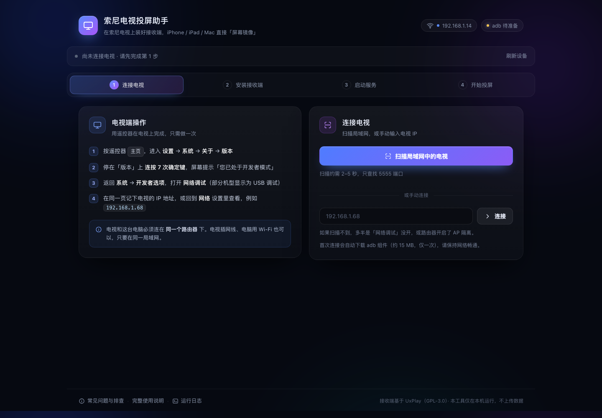
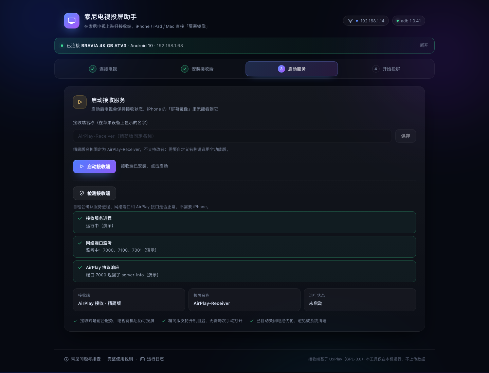

# 索尼电视投屏套件 · Sony TV Cast Kit

给索尼 Android TV 装一个 **AirPlay 接收端**，让 iPhone / iPad / Mac 直接「屏幕镜像」到电视。
自带中文「安装向导」：自动找电视、装 APK、启动服务、检查是否真的可用。

> 适用：Sony BRAVIA（Android TV 7.0+，含 Google TV）
> 苹果端：iOS / iPadOS 12+、macOS 10.14+
> 电脑端（仅安装时用）：macOS 10.13+ / Windows 10+，Python 3.8+




## 为什么需要它

索尼电视本身就是 Android TV，**安卓手机投屏用电视自带的 Chromecast 就行**，不需要装任何东西。
缺的是苹果端的 AirPlay——本套件把经过验证的开源 AirPlay 接收端装到电视上，并配了一个傻瓜式安装向导。

## 快速开始

**方式一（推荐）**：到 [Releases](../../releases/latest) 下载 `索尼电视投屏套件.zip`，解压后：

1. 电视上用遥控器：**设置 → 系统 → 关于 → 版本**（连按 7 次）→ 返回 **系统 → 开发者选项** → 打开 **网络调试**；
2. 双击 `开始使用（macOS）.command`（Windows 用 `Windows-启动.bat`），浏览器会打开安装向导；
3. 扫描并连接电视 → 安装接收端 → 启动 → 点「检测接收端」确认三项全绿；
4. iPhone 控制中心 → **屏幕镜像** → 选 `AirPlay-Receiver`（或你改的名字）。

**方式二（不用电脑）**：把 `apk/AirPlay接收-精简版.apk` 拷进 U 盘，插到电视上用文件管理器安装。

## 安装向导能做什么

- 扫描局域网自动发现电视，也可手动输入 IP
- 首次连接自动下载 adb（约 15 MB，之后复用）
- 一键安装 APK、放行「后台弹出画面」、加入电池优化白名单
- 启动服务并校验进程、端口、AirPlay `/server-info` 接口（**不需要 iPhone 就能自检**）
- 识别电视 CPU 架构，不兼容的安装包自动禁用并提示
- 全功能版可自定义投屏名称

## 两个接收端

| | 精简版 | 全功能版 |
|---|---|---|
| 体积 | 3.2 MB | 26 MB |
| 屏幕镜像 + 声音 | ✅ | ✅ |
| 视频 / 音乐投放、画中画、PIN | ❌ | ✅ |
| 自定义名称 | ❌ | ✅ |
| CPU 架构 | armeabi-v7a（32 位） | arm64-v8a / armeabi-v7a / x86_64 |
| 系统要求 | Android 7.0+ | Android 6.0+ |

> 精简版只有 32 位库，极少数只支持 64 位应用的新机型会提示「不兼容此电视」，改装全功能版即可（向导会自动识别）。

## 从源码运行

```bash
git clone <this-repo>
cd sony-tv-cast-kit
python3 scripts/fetch_apks.py      # 下载并校验两个 APK（约 30 MB）
python3 installer/main.py          # 打开安装向导（--demo 可进入演示模式）
```

安装向导只依赖 Python 标准库，监听 `127.0.0.1`，不联网、不上传数据。

## 构建发布包

```bash
python3 scripts/fetch_apks.py
python3 scripts/build_release.py   # 产出 dist/索尼电视投屏套件.zip + SHA256SUMS.txt
```

推一个 `v*` 标签（如 `git tag v1.1.0 && git push origin v1.1.0`），
再把 `scripts/release-workflow.yml` 复制到 `.github/workflows/release.yml`，Actions 就会自动构建并把 zip 挂到 Release。

> 之所以以模板形式存放：用 OAuth 令牌（非 PAT）推送时，GitHub 要求令牌额外具备 `workflow` 权限才能提交工作流文件。
> 直接在网页上新建 `.github/workflows/release.yml` 粘贴内容，或用 `gh auth refresh -s workflow` 升级权限后推送即可。

## 目录结构

```
installer/            安装向导（Python 标准库 + 原生前端）
  core/               adb 封装、局域网扫描、接收端自检、状态管理
  web/                中文界面（HTML/CSS/JS）
apk/catalog.json      接收端清单（名称、包名、版本、ABI）
scripts/              fetch_apks.py / build_release.py
使用说明.html         面向用户的完整图文说明
预览/                 界面截图
```

## 已验证

- 全功能版在 Android 11（arm64）模拟器上：安装、启动、前台服务、mDNS 广播
  （`_airplay._tcp` / `_raop._tcp`）、7000 端口 `/server-info` 响应均通过；
- 真机投屏（iPhone → 电视）由使用者在实际 BRAVIA 上验证通过。

## 许可证

本项目代码以 **GPL-3.0** 发布，见 [LICENSE](LICENSE)。
分发的两个 APK 为上游 GPL-3.0 项目的原样构建，版权归各自作者，来源与合规说明见 [NOTICE.md](NOTICE.md)。

与 Apple、Sony 无关联。
